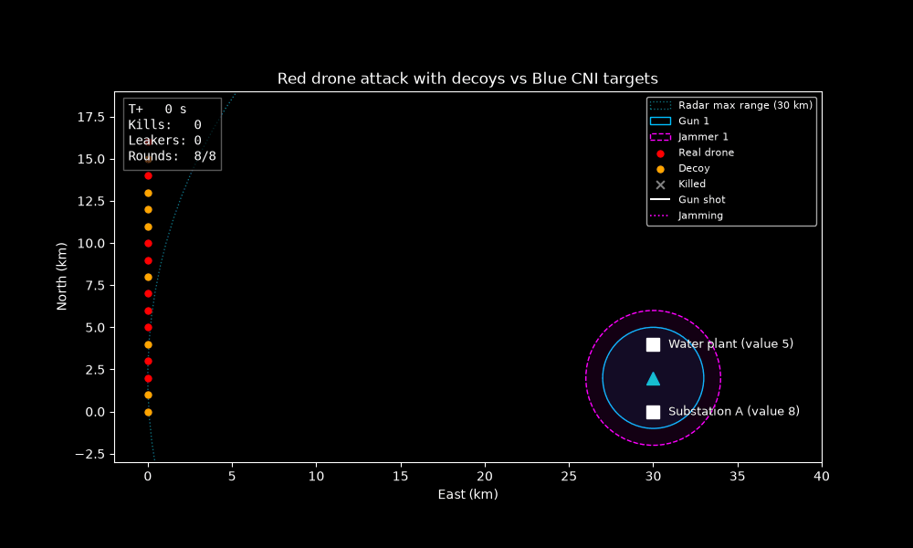
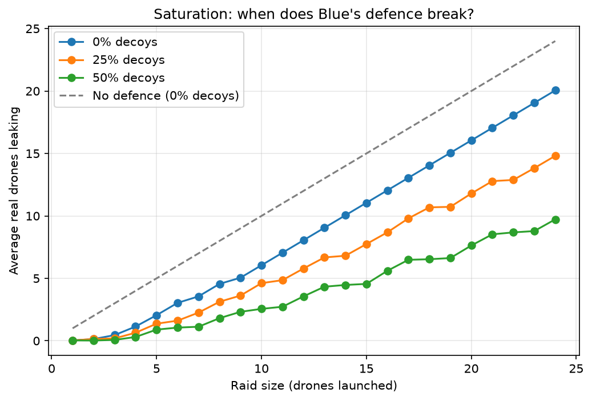
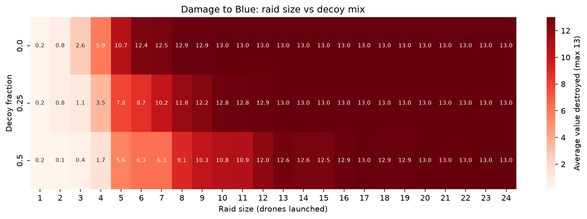
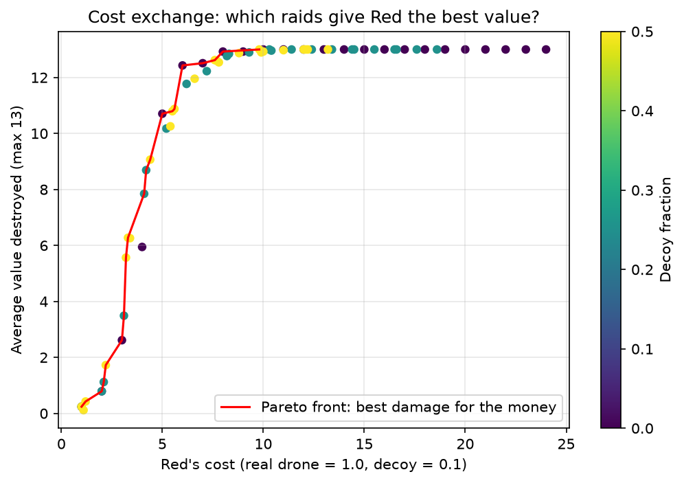

# redsim: counter-drone raid simulator

Monte Carlo simulation of Red drone raids against Blue critical
national infrastructure, defended by a radar, a gun and a jammer.
It runs thousands of seeded raids to find where Blue's defence
saturates, and which raids give Red the most damage for its money.

The GIF shows a raid of 9 real drones and 8 decoys, the cheapest mix
that destroyed both sites in every run. The seed is a typical one,
chosen by kill count close to the average rather than a best/worst case scenario.
Shot lines show the gun and jammer engaging. Drones start leaking
through while the gun still has rounds, because it can only fire once
per time step, and once its magazine runs dry the rest get through.

## Key findings
- **Blue's defence breaks between 5-6 real drones.** Below Blue can survive with low or no damage;
  above it, damage climbs steeply towards all CNI value destroyed.
- **Blue is limited twice.** Rate of fire (one shot per time step)
  bites first when drones arrive together. The magazine is the hard
  ceiling: 8 rounds × 0.5 kill probability ≈ 4 kills per raid. 
- **A few decoys are Red's best value.** With 3 real drones, adding
  2 decoys (cost +0.2) more than doubles damage, from 2.6 to 5.6.
- **Certainty is expensive.** 8 real drones (cost 8.0) destroy both
  sites in about 99% of runs. Guaranteeing it in every run takes
  9 real drones and 8 decoys (cost 9.8), 22% more for the last 1%.
  The model prices the options; how much risk to accept would be a
  command decision.

## Analysis

### Saturation curve

Damage against raid size. The curve is flat for small raids, then
turns sharply upward at between 5-6 real drones: this shows the knee where Blue's
magazine and rate of fire can no longer keep up.

### Heatmap: raid size vs decoy fraction

On damage alone, decoys look like a bad deal for Red: at a fixed
raid size, more decoys means fewer real drones that can hit anything.
Cost effectiveness is explored on the next chart.

### Cost exchange and Pareto front

Each dot is one raid mix: Red's spend against average damage. The
red line is the Pareto front, the raids where no cheaper raid does
at least as much damage. Anything below it is a raid Red should never
choose. The front alternates between adding a real drone and adding
a few cheap decoys, and its biggest jump (cost 4.4 to 6.0) matches
the knee in the saturation curve. Two charts agreeing on the same
point is a useful consistency check.

## How it works
- Each 10 s time step: 1) Blue senses, 2) Blue engages, 3) drones move.
- Radar detection uses the radar horizon, so low drones are seen later.
- The gun engages the drone nearest its target first.
- A sweep (every combination of raid size and decoy fraction) runs
  200 seeded raids per setting.

## Project layout
    redsim/models.py     sites, radars, drones, effectors
    redsim/engine.py     the sense-shoot-move loop
    redsim/scenarios.py  build_scenario: sets up Blue and Red from the dials
    redsim/sweep.py      Monte Carlo sweep, results to CSV
    redsim/analysis.py   saturation, heatmap and cost-exchange charts
    redsim/animate.py    GIF of one typical raid
    tests/               pytest suite

## Running the program
    pip install -r requirements.txt
    python -m pytest -v
    python -m redsim.sweep
    python -m redsim.analysis
    python -m redsim.animate

## Testing and validation
- 22 tests cover the radar physics, engagement rules and engine.
- Analytic check: a single drone facing the gun leaks about 3% of the
  time, matching 0.5⁵ ≈ 3%, the chance of surviving five independent
  shots at a 0.5 kill probability.
- Two tests were written after finding bugs, and each was confirmed
  to fail before the fix:
- The clock advanced once per drone rather than once per step, so
  large raids timed out early and looked less dangerous.
- The gun shot whichever drone was first in the list, so it wasted
  rounds on distant decoys while closer real drones got through.

## Assumptions and limitations
- Drones fly straight at their target at constant speed and altitude.
- Values used for ranges and kill probabilities are illustrative and not based on real equipment. 
- The gun fires once per time step, so the step length sets its rate
  of fire. In the raids shown, rate of fire limits Blue before the
  magazine does.
- Blue cannot tell decoys from real drones.
- Real drones are unjammable; decoys are jammable.
- A decoy costs 0.1 of a real drone. The decoy findings depend on
  this and on Blue's inability to discriminate; changing the notional value
  of a decoy will alter the cost effectiveness of the drone-decoy mix.
- Decoys replace real drones rather than adding to them, so a higher
  decoy fraction also means fewer real drones.
- Launch positions are spread 1 km apart, so bigger raids fly longer,
  angled paths - drones will arrive one after another in quick succession.
- Blue's layout (structures, radar & effectors) is fixed and the model is 2D.
- Results carry Monte Carlo error, roughly ±2% on small percentages
  at 200 runs per setting.

## Next steps for deeper analysis
- Adaptive Red, e.g. a genetic algorithm searching for the best raid
- Sensitivity analysis on decoy cost, kill probability and magazine
- Scenario configs in YAML

## How this was built
I designed the model and wrote the engine, sweep, analysis and tests,
using Claude as a pair programmer. I leaned on it most for the
animation.